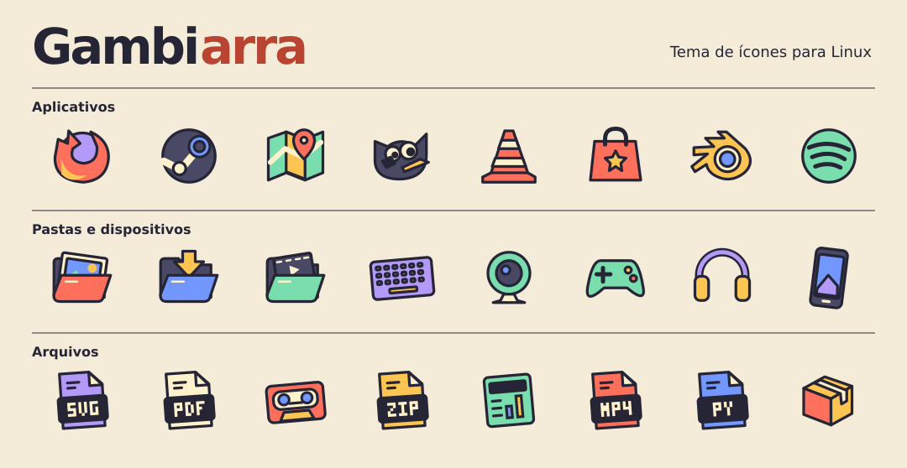

# Gambiarra

[Português](./README.md) · **English**

A vinyl record peeks out of the music folder. A cassette tape marks audio files. The terminal looks like an old CRT monitor. **Gambiarra** is a Linux icon theme drawn with bold ink outlines and the bright colors of a sticker sheet.



**[Download the theme (.tar.gz)](./Gambiarra-Linux.tar.gz?raw=true)**

## Inside the theme

- **Apps** share a palette across the desktop, from Firefox and Steam to GIMP, Blender, VLC, and LibreOffice.
- **Folders and files** hint at what’s inside. An instant photo sticks out of the pictures folder, and file types like PDF, SVG, and MP4 carry their extensions on little labels.
- **Devices and panel icons** cover keyboards, gamepads, headphones, and webcams. Monochrome icons cover common actions and show volume, signal strength, and battery level.

The theme includes **360 distinct SVGs** across all variants. They cover **537 icon names** because the name a desktop looks up can vary by distribution or by how an app was installed.

## Install

Open a terminal in the folder where you downloaded the archive. Run these commands to install the theme for your user account.

```sh
mkdir -p ~/.local/share/icons
tar -xzf Gambiarra-Linux.tar.gz -C ~/.local/share/icons
```

| Desktop | How to activate Gambiarra |
| --- | --- |
| GNOME | Run `gsettings set org.gnome.desktop.interface icon-theme 'Gambiarra-Linux'`. |
| KDE Plasma | Search for **Icons** in **System Settings**, select **Gambiarra**, and click **Apply**. |
| Xfce | Open **Appearance → Icons** and select **Gambiarra**. |

To switch back, select your previous icon theme. Gambiarra’s files are in `~/.local/share/icons/Gambiarra-Linux/`.

## Explore the artwork

Both the [full-color icons](./Gambiarra-Linux/scalable/) and the [symbolic icons](./Gambiarra-Linux/symbolic/) are editable SVGs. The [theme index](./Gambiarra-Linux/index.theme) lists the icon directories. When Gambiarra doesn’t include an icon, the desktop looks for it in Adwaita, Breeze, and hicolor, in that order.

The package was tested on Ubuntu with GTK 3. Every SVG loaded successfully, and GTK found all 537 icon names in the theme.
