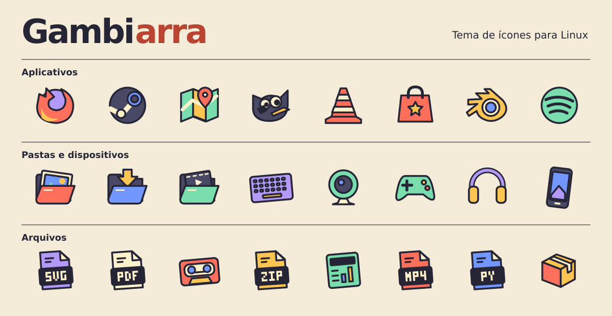

# Gambiarra

Um vinil escapando da pasta de música, uma fita cassete para os arquivos de áudio e um terminal com cara de monitor de tubo. **Gambiarra** é um tema de ícones para Linux desenhado com contornos de tinta e cores de adesivo.



**[Baixe o tema (.tar.gz)](./Gambiarra-Linux.tar.gz?raw=true)**

## O que vem no pacote

- **Aplicativos** como Firefox, Steam, GIMP, Blender, VLC e LibreOffice ganharam desenhos na mesma paleta.
- **Pastas e arquivos** têm pistas do que guardam. A pasta de fotos tem uma polaroide, e formatos como PDF, SVG e MP4 trazem a extensão desenhada na etiqueta.
- **Dispositivos e painel** incluem teclado, controle, fones e webcam, além de versões monocromáticas para ações, volume, sinal de rede e carga da bateria.

São **360 SVGs distintos** contando as variantes, distribuídos por **537 nomes** que o desktop pode procurar. Alguns aplicativos usam nomes diferentes conforme a distribuição ou o formato de instalação.

## Instalar

Abra o terminal na pasta onde baixou o pacote e rode estes comandos. A instalação vale para o seu usuário.

```sh
mkdir -p ~/.local/share/icons
tar -xzf Gambiarra-Linux.tar.gz -C ~/.local/share/icons
```

| Ambiente | Como ativar |
| --- | --- |
| GNOME | Rode `gsettings set org.gnome.desktop.interface icon-theme 'Gambiarra-Linux'` |
| KDE Plasma | Em **Configurações do Sistema**, procure **Ícones**, escolha **Gambiarra** e aplique |
| Xfce | Abra **Aparência → Ícones** e escolha **Gambiarra** |

Para voltar ao visual anterior, selecione o tema que você usava. Os arquivos do Gambiarra ficam em `~/.local/share/icons/Gambiarra-Linux/`.

## Por dentro dos desenhos

Os [ícones coloridos](./Gambiarra-Linux/scalable/) e os [ícones simbólicos](./Gambiarra-Linux/symbolic/) estão em SVG editável. O [índice do tema](./Gambiarra-Linux/index.theme) organiza as pastas e define onde o desktop procura desenhos complementares, na ordem Adwaita, Breeze e hicolor.

O pacote foi testado no Ubuntu com GTK 3. A verificação carregou cada SVG e confirmou a busca dos 537 nomes no tema.
